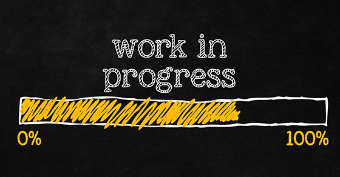

<!--
Maintainer:   jeffskinnerbox@yahoo.com / www.jeffskinnerbox.me
Version:      0.0.0
-->

<div align="center">

</div>


---------------


[ASCII art](https://en.wikipedia.org/wiki/ASCII_art) is old, but still entertaining in the geek world.
It’s about displaying images that are not composed of pixels but of ASCII characters, in other words composed of plain old text characters.

Do you remember when computer graphics meet
[ASCII characters on paper via a teletype terminal](http://hackaday.com/2016/06/28/retrotechtacular-ascii-art-in-the-19th-century/)?
Well you can still find it in Linux .... [check out asciiview](http://manpages.ubuntu.com/manpages/precise/man1/aview.1.html).
Also see [jp2a](https://github.com/cslarsen/jp2a),
[libcaca](http://caca.zoy.org/wiki/libcaca),
[img2txt](https://github.com/hit9/img2txt),
and there are
[others](http://melitamihaljevic.blogspot.com/2012/08/generating-ascii-art-linux-python.html).
You can even take [ASCII pictures on your smartphone](https://hackaday.com/2017/11/25/asciicam-make-ascii-art-with-your-phone/).

* [RETROTECHTACULAR: ASCII ART IN THE 19TH CENTURY](https://hackaday.com/2016/06/28/retrotechtacular-ascii-art-in-the-19th-century/)
* [7 Linux commands to use just for fun](https://opensource.com/article/21/11/fun-linux-commands)
* [Christopher Johnson's ASCII Art Collection](https://asciiart.website/)
* [Convert Images to ASCII Art in Linux Terminal With This Nifty Little Tool](https://itsfoss.com/ascii-image-converter/)
* [How To Convert Images Into ASCII Format In Linux](https://ostechnix.com/how-to-convert-images-into-ascii-format-in-linux/)
* [How to convert a jpg image to ASCII using the Linux command line](https://securitronlinux.com/bejiitaswrath/how-to-convert-a-jpg-image-to-ascii-using-the-linux-command-line/)

* [Online Tool Turns STLs Into 3D ASCII Art](https://hackaday.com/2022/01/22/online-tool-turns-stls-into-3d-ascii-art/)

# Cowsay

* [Use the Linux cowsay command for a colorful holiday greeting](https://opensource.com/article/21/11/linux-cowsay)

* [ASCII Art Generator](https://asciiart.club/)
* [Figlet](https://www.patorjk.com/software/taag/#p=display&f=Graffiti&t=Type%20Something%20)

* [Rich Pixels](https://simonwillison.net/2025/Sep/2/rich-pixels/)
  * [GitHub: darrenburns/rich-pixels](https://github.com/darrenburns/rich-pixels)

---------------


# Converts jpg Images to Colored ASCII

* [GitHub: cslarsen/jp2a](https://gxgithub.com/cslarsen/jp2a)
* [Convert Images to ASCII Art in Linux Terminal - jp2a](https://www.youtube.com/watch?v=O0xpTtdPD4w)

* [GitHub: TheZoraiz/ascii-image-converter](https://github.com/TheZoraiz/ascii-image-converter)

## NeoVim Startup Screen

I'm a fan of the [rebelot/kanagawa.nvim](https://github.com/rebelot/kanagawa.nvim) color scheme

[The-Great-Wave-Off-Kanagawa.jpg](https://upload.wikimedia.org/wikipedia/commons/a/a5/Tsunami_by_hokusai_19th_century.jpg)
[Kanagawa-logo.png](https://github.com/rebelot/kanagawa.nvim/blob/master/kanagawa%402x.png)

```bash
sudo apt install aview
asciiview The-Great-Wave-Off-Kanagawa.jpg
```

```bash
$ identify The-Great-Wave-Off-Kanagawa.jpg
The-Great-Wave-Off-Kanagawa.jpg JPEG 3859x2594 3859x2594+0+0 8-bit sRGB 2.24513MiB 0.000u 0:00.001

$ identify kanagawa-logo.png
kanagawa-logo.png PNG 1200x1200 1200x1200+0+0 8-bit sRGB 840286B 0.000u 0:00.000
```

### Converts JPG Images to ASCII
`jp2a` is a simple JPEG to ASCII converter.

* [GitHub: Talinx/jp2a](https://github.com/Talinx/jp2a)
* [GitHub: cslarsen/jp2a](https://github.com/cslarsen/jp2a)
* [Homebrew Formulae](https://formulae.brew.sh/formula/jp2a)
* [Convert Images to ASCII Art in Linux Terminal - jp2a](https://www.youtube.com/watch?v=O0xpTtdPD4w)

```bash
sudo apt install jp2a

jp2a --help

jp2a --colors --fill --color-depth=24 --size=175x55 The-Great-Wave-Off-Kanagawa.jpg

jp2a --colors --fill --color-depth=24 --size=130x50 kanagawa-logo.png

jp2a --colors --fill --color-depth=8 --term-height Tsunami_by_hokusai_19th_century.jpg

jp2a --colors --color-depth=8 --term-height Tsunami_by_hokusai_19th_century.jpg
```


---------------


# ASCII Camera

Watch your webcam feed in a terminal window

* [This cool Raspberry Pi project turns your webcam feed into ASCII art](https://www.xda-developers.com/raspberry-pi-project-webcam-ascii/)
* [Maker builds Raspberry Pi ASCII camera, turning video frames into text-based imagery](https://www.tomshardware.com/raspberry-pi/maker-builds-raspberry-pi-ascii-camera-turning-video-frames-into-text-based-imagery)
  * [I had only 3 days to build this Raspberry Pi Project (ASCII Video Camera)](https://www.youtube.com/watch?v=i9Zj2qN0uJ8)

* [Doing networked video ASCII art in Python](https://mina-pecheux.medium.com/doing-networked-video-ascii-art-in-python-4725b3ee552b)
* [From Pixels to Characters: Creating ASCII Videos with OpenCV (Including YouTube Playback)](https://medium.com/@yasirulaki04/from-pixels-to-characters-creating-ascii-videos-with-opencv-including-youtube-playback-00d077409f3a)

* [GitHub: joelibaceta/video-to-ascii](https://github.com/joelibaceta/video-to-ascii) - It is a simple python package to play videos in the terminal using characters as pixels

* [Turn Videos Into ASCII Art Videos](https://www.instructables.com/Turn-Videos-Into-ASCII-Art-Videos/)

## AlexEidt
* [Achieving Real-Time Color ASCII Rendering in Python](https://www.youtube.com/watch?v=SzqKClkCi_0)
  * [GitHub: AlexEidt/ASCII-Video](https://github.com/AlexEidt/ASCII-Video)
  * [GitHub: AlexEidt/ASCII-Vision](https://github.com/AlexEidt/ASCII-Vision)


```bash
mpv --quiet -vo=caca https://www.youtube.com/watch?v=dQw4w9WgXcQ
```

---------------

# Pencil Sketch Renderer
* [GitHub: AlexEidt/Pencil](https://github.com/AlexEidt/Pencil)

---------------

# Etch-A-Sketch Camera
Teka-sketch, an Etch-a-Sketch that renders actual video!

* [Etch-A-Sketch Projects](https://blog.adafruit.com/page/2/?s=Etch-A-Sketch)
* [This Etch-A-Sketch Camera Now Draws Movies](https://www.youtube.com/watch?v=jYDcix_bceI)
