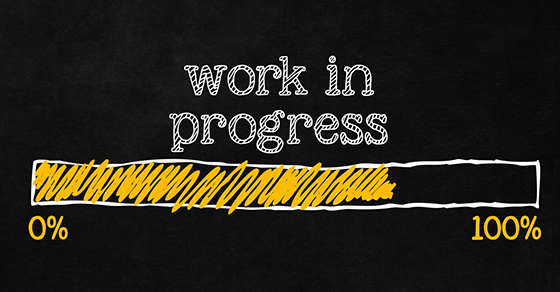

<!--
Maintainer:   jeffskinnerbox@yahoo.com / www.jeffskinnerbox.me
Version:      0.0.0
-->

---------------

* [Set up OpenClaw on your Raspberry Pi](https://www.raspberrypi.com/news/set-up-openclaw-on-your-raspberry-pi/)

* [OprnClaw Sandboxing](https://docs.openclaw.ai/gateway/sandboxing)
* [Running OpenClaw with Ollama](https://www.kdnuggets.com/running-openclaw-with-ollama)

